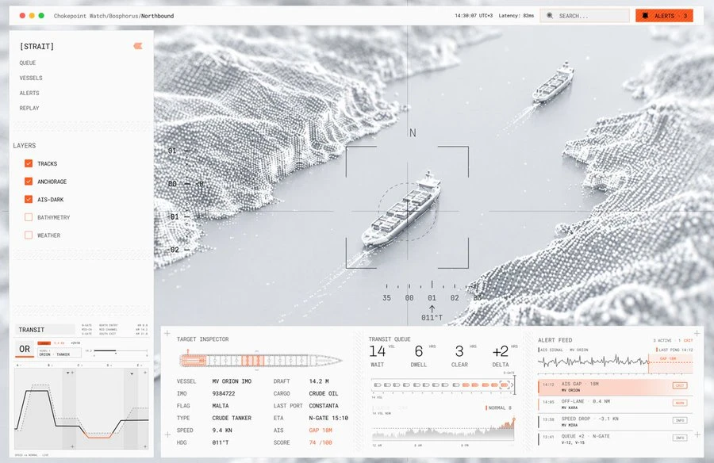

# Inspiración visual

Referencias de diseño para el visor. No son productos a copiar: se anota qué elementos sirven y por qué.

## Chokepoint Watch (Bósforo)

Origen: imagen compartida por el usuario el 2026-10-26; autor y fuente sin identificar.

Visor de tráfico marítimo en un estrecho. Lo que sirve para el visor climático:

- **Escena 3D de nube de puntos** (terreno como partículas grises sobre fondo claro): da sensación de dato medido,
  no de foto satelital. Aplicable al relieve de Neuquén y el Alto Valle.
- **Paleta casi monocroma + un solo color de acento** (naranja) reservado para alertas y anomalías.
- **Tipografía monoespaciada** y estética de instrumento (retícula, rumbo, escala angular).
- **Panel lateral de capas** con checkboxes (en el visor: lluvia, temperatura, cuencas, eventos históricos).
- **Inspector del objeto seleccionado** con ficha de atributos (en el visor: evento o punto, con fecha, mm,
  período de retorno, fuente y período del dato).
- **Feed de alertas** con hora, severidad y etiqueta.
- **Series temporales compactas** con banda "normal" y el desvío resaltado en el acento (en el visor: valor actual
  contra climatología con intervalo).
- **Modo replay**: reproducir un evento pasado hora por hora (en el visor: la tormenta del 8 de abril en Neuquén).
- **Barra superior con estado** (hora, latencia): en el visor, fecha del último dato y fuente.
